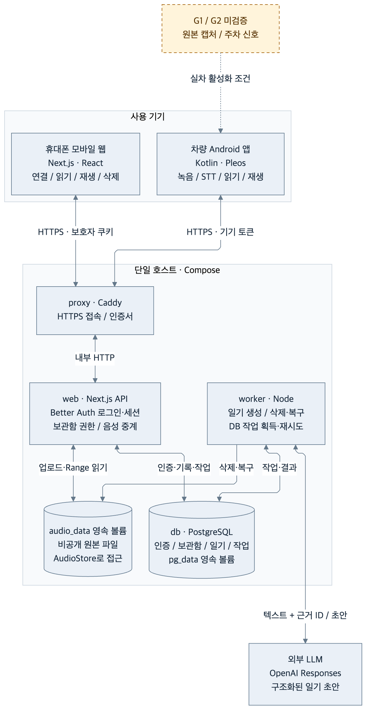
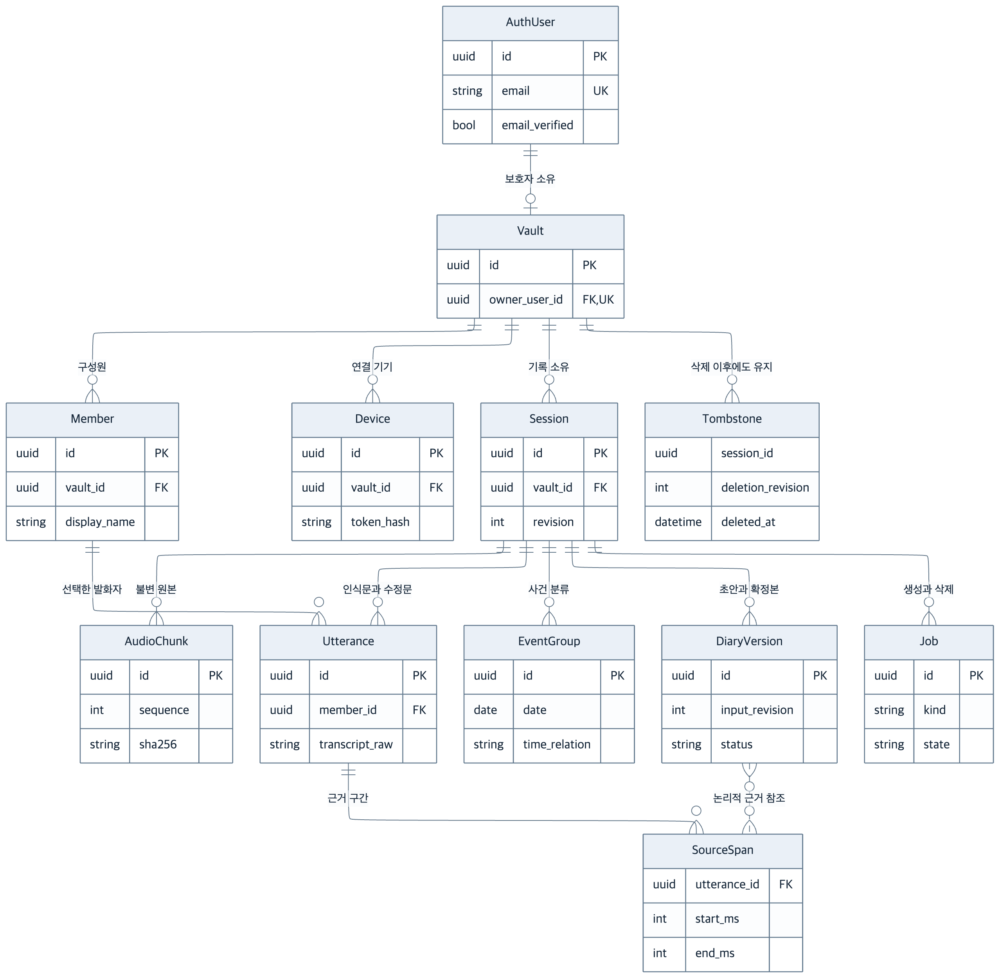
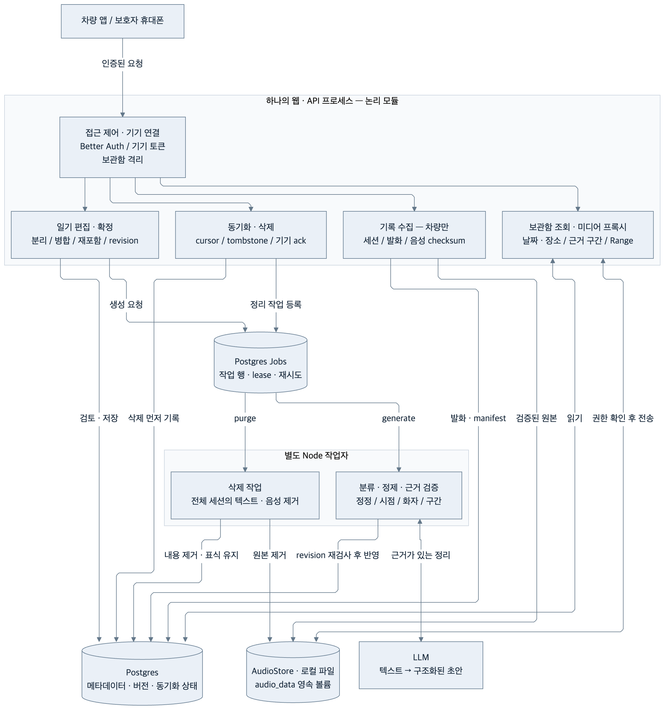

# 가족 여행일기 아키텍처

2026-11-08 작성. [구현 계획](../../specs/001-family-trip-memory/plan.md),
[데이터 모델](../../specs/001-family-trip-memory/data-model.md),
[API 계약](../../specs/001-family-trip-memory/contracts/http-api.md)및 [실행·저장 계약](../../specs/001-family-trip-memory/contracts/runtime-and-storage.md)의
Docker Compose 변경 기준선을 시각화했다. 이전 Supabase 계획(`a92e9f1`)은 사용자 결정으로 대체했다.
아래는 구현·배포 전 설계다. 실제 차량 원본 캡처(G1)와 주차 판정(G2)은 미검증이다.

## 1. 시스템 — 무엇이 어디에서 실행되는가



[확대용 SVG](system.svg) · [편집용 Mermaid](system.mmd)

차량은 Kotlin/Pleos 앱, 휴대폰은 Next.js 모바일 웹이다. 둘 다 인증된 API로 같은 가족 보관함에 접근한다.
서버는 보관함 권한을 검사하고 원본 음성을 중계한다. 일기 생성·삭제 작업자는 API와 별도 프로세스이며
Postgres 작업 행을 획득해 처리한다. API와 작업자는 TypeScript 계약·일기 도메인 코드를 공유한다.
단일 호스트에서 Compose로 Caddy·Next.js API·Node 작업자·PostgreSQL을 운영한다.
로그인은 웹 내부 Better Auth 라이브러리와 PostgreSQL DB 세션을 사용한다.
원본은 API·작업자가 공유하는 비공개 파일 볼륨에 두고 AudioStore를 통해 읽거나 지운다.
외부 LLM에는 텍스트와 근거 ID를 전달한다.
원본 음성과 정밀 좌표는 생성 모델에 전송하지 않는다.

실기기는 같은 HTTPS origin으로 접속한다. Caddy만 외부 포트를 열고 DB·음성 볼륨은 직접 공개하지 않는다.
그림에서는 일회성 migrate와 개발용 Mailpit, 인증서 보관 볼륨을 생략했다.
DB 준비와 SQL 적용이 성공한 뒤 앱을 시작한다. 향후 같은 이미지를 클라우드 VM으로 옮길 수 있으며,
DB와 원본 데이터 이전은 별도 백업·복사·검증이 필요하다.

차량의 암호화 파일·Room outbox는 일시적인 통신 실패를 처리한다. 휴대폰은 온라인 읽기·재생을 제공한다.
휴대폰 웹의 JavaScript는 브라우저에서 실행되고 같은 Next.js 서비스가 페이지와 API를 제공한다.
차량 녹음·읽기·편집·재생은 확인된 주차 상태에서만 활성화한다. 주차 상태 불명·상실 때 중단한다.

## 2. 데이터 — 일기에서 실제 목소리로 돌아가는 연결



[확대용 SVG](data.svg) · [편집용 Mermaid](data.mmd)

- **AuthUser**는 Better Auth의 보호자 계정이다. auth 스키마의 인증 세션·자격·검증 토큰은 도식에서 생략했다.
- **Vault**는 한 보호자가 관리하는 가족 보관함이다. Member는 선택한 이름이며 별도 계정·자동 음성 신원이 아니다.
- **Session**은 자유롭게 말한 하나의 이야기 세션이다. **AudioChunk**는 내부 처리용 음성 조각이며 사용자에게 짧게 말하도록 요구하지 않는다.
- **Utterance**에는 원래 인식문과 수정문을 구분해 보관한다. 수정문이 바뀌어도 원본 녹음은 바뀌지 않는다.
- **EventGroup**은 사건·장소·시점을 분류한 묶음이다. **DiaryVersion**은 그 결과와 사람별 기억·공동 문장·검토 상태를 버전별로 보관한다.
- **SourceSpan**은 발화의 시작·끝 시간이다. 한 문장은 여러 구간을 참조할 수 있고, 하나의 구간은 여러 음성 조각에 걸칠 수 있다. 이를 통해 일기 문장에서 당시 목소리를 찾아 듣는다.
- **Tombstone**은 본문 없는 삭제 표식이다. 세션 내용이 제거된 이후에도 남아 오프라인 사본의 재업로드를 막는다.

논리 ERD이며 SQL 마이그레이션은 아직 없다. 관계선은 소유·참조를 나타내며 필드는 일부만 표시했다.
점선의 DiaryVersion–SourceSpan은 출력 안의 문장별 근거 참조로, 별도 조인 테이블을 확정한 표시가 아니다.
모든 저장 데이터의 보관함 격리와 동일 세션 검증은 원문 데이터 모델을 따른다.
기기 연결 코드(Pairing), 변경 목록(Change), 기기 삭제 확인(DevicePurgeAck), 멱등 요청(Idempotency)은
도식의 가독성을 위해 생략했으며 구현 범위에는 포함된다.

## 3. 서비스 — 각 기능을 누가 책임지는가



[확대용 SVG](services.svg) · [편집용 Mermaid](services.mmd)

| 모듈 | 책임 |
|---|---|
| 접근 제어·기기 연결 | 보호자 세션·차량 토큰 확인, 보관함 격리, 연결·해제 |
| 기록 수집 | 차량 세션·발화·음성 수신, checksum과 완료 manifest 검증 |
| 일기 편집·확정 | 생성 요청, 사건 분리·병합·재포함, 사용자 검토·버전 관리 |
| 보관함 조회·미디어 프록시 | 날짜·장소 조회, 근거 구간·전체 원본의 인증된 Range 재생 |
| 동기화·삭제 | 변경 cursor, 삭제 표식 우선 적용, 기기별 완료·대기 상태 |
| 생성 작업자 | 자유 발화 분류·정제, 근거·시점·화자 검증, 입력 revision 재검사 |
| 삭제 작업자 | 관련 일기·발화·음성 제거, 실패 재시도, 삭제 표식 유지 |

웹 안의 네 기능은 같은 API 프로세스의 논리 모듈이다. 각각을 독립 서비스로 배포하는 계획이 아니다.
Better Auth는 API 내부 라이브러리이고, AudioStore는 공유 코드의 저장 인터페이스다.
초기 구현은 파일 볼륨이며 나중에 객체 저장 adapter로 교체한다. 별도 파일 서버 컨테이너를 추가하지 않는다.
그림의 Postgres와 Postgres Jobs도 **같은 데이터베이스**이며 책임을 구분해 그렸다.
생성 요청과 삭제 요청은 DB 작업 행에 남는다. 작업자는 lease를 획득하고 실패 시 재시도한다.
생성 완료 시 입력이 수정되었거나 삭제되었다면 이전 결과로 덮어쓰지 않는다.

전체 세션 삭제는 먼저 접근을 차단하고 삭제 표식을 남긴다. 이후 원본과 모든 일기 버전을 제거한다.
오프라인 차량의 사본은 다음 연결에서 삭제하고 완료 확인을 돌려준다. 일기에서 문장을 제외하는 편집은
원본 삭제가 아니므로 생략된 말도 다시 듣거나 재포함할 수 있다.

## 도식 선택·재생성

로컬 **UML and Software Architecture Visualization** 스킬을 적용했다.
시스템은 C4 관점의 구성도, 데이터는 논리 ERD, 서비스는 모듈 책임도다. 정식 UML 모델 교환용 산출물은 아니다.
문서 중심 검토와 수정이 목적이므로 Mermaid를 선택했고, 렌더링을 지원하지 않는 화면에서는 PNG/SVG를 사용한다.
원본 `.mmd`가 수정 정본이며 이미지는 같은 원본에서 생성한다. 접근성 제목·설명과 본문의 텍스트 해설을 함께 제공한다.

렌더러는 `@mermaid-js/mermaid-cli@11.12.0`, 배치는 ELK, 스타일은 `mermaid-config.json`이다.
Chrome 실행 경로는 각 환경의 별도 Puppeteer 설정 파일에 둔다. 저장소 루트에서 다음과 같이 실행한다.

```sh
# 처음에는 CLI 패키지를 내려받아야 한다. Chrome이 이미 있다면 번들 다운로드를 생략할 수 있다.
PUPPETEER_SKIP_DOWNLOAD=true npm exec --yes --package=@mermaid-js/mermaid-cli@11.12.0 -- \
  mmdc -i docs/architecture/system.mmd -o docs/architecture/system.svg \
  -c docs/architecture/mermaid-config.json -p /path/to/puppeteer-config.json -b white
```

`system`을 `data`, `services`로 바꿔 각 도식을 렌더링한다. PNG는 출력 확장자를 `.png`로 바꾸고 `-s 2`를 추가한다.
세 도식의 SVG·PNG 렌더링과 한글·표·연결선의 시각 검사를 수행했다. 이는 앱·SDK 동작 검증과 구분한다.
