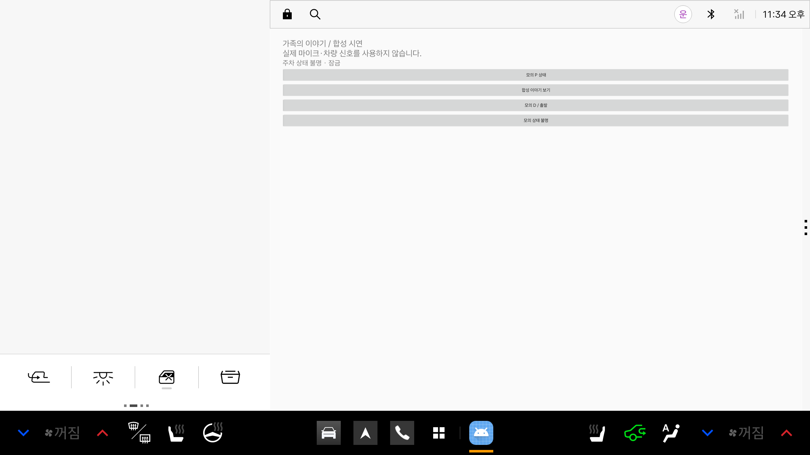

# G0 개발 환경 — 부분 확인 (2026-11-08)

## 실행한 환경과 결과

- 호스트 ARM64 Mac, JDK Corretto17.0.20, Node24.18.0, pnpm11.13.1.
- Android platform35/build-tools35.0.0/platform-tools37.0.1.
- Kotlin2.0.0 / AGP8.8.2 / Gradle8.10.2, min28/target35 조합 빌드 성공.
- `assembleDemoDebug`, `testDemoDebugUnitTest`(4개), `assemblePleosRelease` 성공. Pleos release는 서명 전 산출물이며 제출 가능한 완성 APK가 아니다.
- Android Emulator37.2.13 ARM64 + **Pleos Connect2.1.0 API34 ARM64 공식 이미지**를 headless로 부팅. `sys.boot_completed=1`, `ro.product.cpu.abi=arm64-v8a`.
- demo APK를 `adb install -r`로 설치(Success), MainActivity 실행(Status: ok, COLD, TotalTime1081ms), 스크린샷 확인.
- 차량 화면의 모의 P/D는 합성 시연용이다. 원본 캡처·STT·실제 차량 신호를 호출하지 않는다.

## 설치 재현 정보

SDK/AVD/Gradle 캐시는 무시되는 `.tools/` 안에 있다. SDK·AVD 바이너리는 Git에 올리지 않는다.
공식 ZIP 체크섬을 확인한 뒤 SDK에 풀고, 번들 `devices.xml`의 ARM64/API34/2560×1440/4GB 값을 사용해 별도 AVD를 만들었다.

| 파일 | 공식 SHA1 |
|---|---|
| commandlinetools-mac_x86_64-16111833_latest.zip | 112cf9618794a997ff273537d55bee02c22abffe |
| emulator-darwin_aarch64-16740729.zip | 6c5e61b873e11c7d1d08683bea089f762baee070 |
| crp_car_arm64_emulator.zip | 24d28eb2f18eba5e87c861a7eb2bdccebb049419 |

최신 command-line tools 호환 명령은 x86 emulator를 선택했으므로, `repository2-3.xml`의 host-arch=aarch64 archive로 교체했다. AGP는 최신 SDK XML에 대한 경고를 냈으나 위 빌드·테스트는 성공했다.

## 아직 통과하지 않은 항목

G0 전체 완료가 아니다. 후속 probeDebug에서 SpeechToText3.3.1 의존성·STT_SERVICE 권한·ON_DEVICE 초기화는 확인했다.
ON_DEVICE만 사용하므로 앱 등록 자격 증명은 사용하지 않았다. Vehicle SDK 초기화·실제 P 신호는 아직 미검증이다.
G1 원본 파일 저장·재생 및 합성 PCM의 한국어 인식 콜백은 [부분 검증](g1-capture.md)했으나,
실제 사용자 발화·누락 없는 STT·긴 입력은 남아 있다. G2는 미검증이며 제품 포트는 잠금을 유지한다.
`CapabilityProbe`는 Android 환경과 미검증 상태를 표시하며, Automotive feature만으로 Pleos SDK 성공을 판정하지 않는다.

## 보유 기기별 역할

| 기기 | 가능한 테스트 | 이번에 확인한 범위 |
|---|---|---|
| ARM64 MacBook | Android/Pleos 에뮬레이터, APK 빌드, Docker, 웹 | Pleos 부팅 + demo APK 설치·실행 |
| Windows 데스크톱 | Windows용 Pleos 에뮬레이터와 APK, 웹 | 이 PC에서는 미실행, 가상화·RAM 사양 확인 필요 |
| iPhone | Safari 모바일 웹 읽기·재생·계정 연결 | 실제 기기 미검증, APK 직접 실행 불가 |
| iPad | Safari 태블릿 웹 읽기·재생 | 실제 기기 미검증, APK 직접 실행 불가 |

공식 출처: [Pleos 설치 안내](https://document.pleos.ai/en/docs/connect/guide/getting-started/application-development/setup-connect-sdk-emulator), [Mac Pleos 이미지 저장소](https://nexus-playground.pleos.ai/repository/raw-releases/connect-avd/2.x/crp-arm64-sys-img.xml), [Android SDK 저장소](https://dl.google.com/android/repository/repository2-3.xml).
