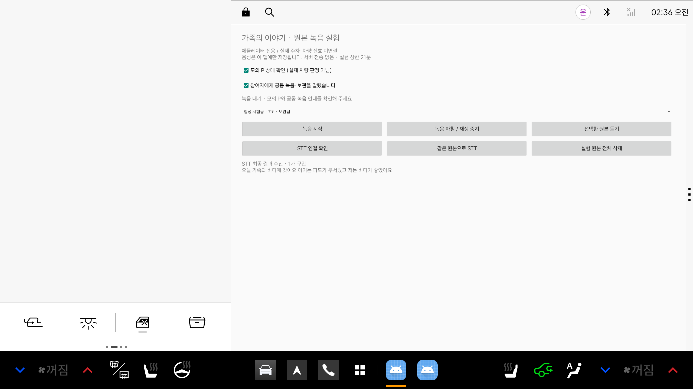

# G1 원본 캡처 — 부분 검증 (2026-11-08)

**G1 전체 통과 아님.** 별도 `probeDebug`에서 원본 파일 입출력과 SDK 인식 콜백을 확인했다.
실제 사용자 발화 녹음·20분 입력·구간 정합성·누락 없는 최종 인식은 남아 있다. T005는 미완료로 유지한다.

## 구현

- `io.hmg.familydiary.probe` / 에뮬레이터(ranchu/goldfish) + DEBUG에서만 실행. probeRelease 비활성.
- 실험자가 모의 P와 공동 녹음 안내를 확인한 후 수동 시작. Android RECORD_AUDIO 런타임 권한.
- AudioRecord MIC, 16,000Hz / PCM signed16 little-endian / mono. 3,200-byte 읽기 버퍼.
- 앱 전용 `files/capture-probe/UUID.partial`에 쓰고 1초마다 header/fsync, 정상 마침 시 `.wav`로 rename.
  화면 이탈·포커스 상실·모의 P 해제는 `.interrupted.wav`. 쓰기 오류의 미완료 파일은 완료 목록에서 제외.
- MediaPlayer 원본 재생, 이전 파일 선택, 전체 삭제. 녹음·재생·인식 동시 실행 차단과 자동 재개 금지.
- Pleos SpeechToText3.3.1 ON_DEVICE / Locale.KOREA(ko-KR). WAV의 44-byte header를 제외한 동일 PCM을
  100ms 분량으로 전송하고 마지막에 completeAudioSend 호출. SDK request()로 별도 마이크를 열지 않는다.
- 인식 완료 구간 누적. SDK의 한 구간 종료만으로 남은 파일 전송을 취소하지 않는다.
  인식 중간 결과와 최종 확정 결과를 구분하며 앱이 음성·인식문을 로그나 서버로 내보내지 않는다.
- probe merged manifest에서 INTERNET 권한 제거 확인. 제품 pleos release에는 RECORD_AUDIO/STT 권한 및 probe UI가 없다.

이 저장소는 제품의 암호화 LocalStore(T008)가 아니다. 실험용 평문 파일이며 outbox·chunk 복구·동기화는 미구현이다.
실험 상한 21분, 시작 시 여유 공간 64MiB 확인. 이는 제품의 자유 발화 형식을 제한하는 정책으로 확정한 값이 아니다.

## 실행 증거

환경: Mac ARM64, Pleos Connect2.1.0 API34 ARM64 AVD, emulator37.2.13, Speech SDK3.3.1,
설치 서비스 `ai.pleos.playground.caas` **4.2.10-coral-aosp**, Android 현재 사용자10.

| 검사 | 관측 | 판단 |
|---|---|---|
| SDK 초기화 | ON_DEVICE onSuccess, STT_SERVICE normal permission | 초기화 성공. 인식 품질 증거와 분리 |
| AudioRecord 파일 | 호스트 마이크 입력 비활성 상태에서 117.675초, PCM3,765,600bytes + header44 | 쓰기·화면 이탈 후 보관 확인. 사용자 발화 검증 아님 |
| 입력 내용 | peak8, RMS약4.72/32768의 미세한 기저 신호 | 완전한 0 신호나 실제 발화라고 표시하지 않음 |
| 동일 파일 재생 | MediaPlayer 준비·재생 상태와 duration117초 화면 확인 | 재생 경로 확인. 사람이 목소리를 들었다는 증거 아님 |
| 합성 한국어 STT | macOS Yuna로 생성한 4.984625초 문장. 앞0.5초/뒤2초 무음 포함 파일에서 completed 콜백 | PCM 파일→한국어 인식 콜백 확인. 전체 문장 누락/중복 관측으로 품질 통과 아님 |
| 언어 오류 재현 | Locale.KOREAN(ko)에서 ON_DEVICE_ENGINE_ERROR, Locale.KOREA(ko-KR)로 수정 후 인식 결과 | 공식 지원 지역 코드 필요 |
| 기기 테스트 | 30초 대기 후 녹음 정상 마침, 실제 시작·종료 시각 대비 PCM 길이 확인, 재생 시작, 모의 P 해제 중단, 재주차 자동 재개 없음, 다음3초 녹음 중단, 이전 원본 checksum 불변 | Instrumentation 1개 시나리오 통과. 실제 차량 P 이벤트 검증 아님 |
| JVM 테스트 | CaptureCoordinator4 + PcmWave5 + SpeechTranscript3 | 12개 통과 |
| APK | assembleProbeDebug / assemblePleosRelease | 성공. pleos release는 여전히 주차 불명 잠금·서명 전 APK |

합성 STT 입력: “오늘 가족과 바다에 갔어요. 아이는 파도가 무서웠고 저는 바다가 좋았어요.”
현재 실행에서 최종 콜백은 돌아왔지만 문장 일부만 포함하거나 단어가 반복됐다. 앱은 이를 일기 완료로 처리하지 않는다.
이 결과만으로 실제 자유 발화 STT·G1 성공을 선언하지 않는다. 파일 전송 종료/EPD·모델 동작을 추가로 분리 검증해야 한다.



원본·합성 음원·인식 로그는 커밋하지 않는다. 스크린샷은 위 합성 문장과 가상 차량 화면만 포함한다.
UI 클릭 주입은 차량 시스템 화면 전환 중 누락된 경우가 있어, 녹음 종료·P 해제의 재현 가능한 판정은
실제 Activity 컨트롤을 실행하는 기기 테스트로 확인했다.

## 테스트 재현 과정

최초 legacy InstrumentationTestRunner 실행은 통과했지만, 에뮬레이터 창으로 재부팅한 뒤
startup ANR/REMOVE TASK로 재실행이 중단됐다. AndroidX runner1.6.2로 교체했다.
UI 호출 지연으로 30초 sleep 뒤 실제 녹음 길이가 36.405초였던 실행이 있어, 고정된 sleep 길이 대신
메인 스레드에서 실제 시작·종료 동작 시각을 측정해 PCM 길이와 비교한다. 허용 오차는 2초이며,
이는 원본 구간 탐색 정확도 1초 목표나 실제 출발 중단 지연을 통과시킨 검사가 아니다.
보정 후 화면이 있는 Pleos 에뮬레이터에서 `OK (1 test)`, 36.948초로 최종 시나리오 통과를 확인했다.

## 재현

호스트 마이크 없이 기기 회귀 검사:

```sh
./scripts/run-vehicle-emulator.sh -no-window
./scripts/vehicle-gradle.sh :app:assembleProbeDebug :app:assembleProbeDebugAndroidTest :app:testProbeDebugUnitTest :app:assemblePleosRelease
.tools/android-sdk/platform-tools/adb -s emulator-5580 install -r apps/vehicle/app/build/outputs/apk/probe/debug/app-probe-debug.apk
.tools/android-sdk/platform-tools/adb -s emulator-5580 install -r apps/vehicle/app/build/outputs/apk/androidTest/probe/debug/app-probe-debug-androidTest.apk
# 현재 사용자10인 이 AVD 기준. 다른 AVD는 am get-current-user로 확인한다.
.tools/android-sdk/platform-tools/adb -s emulator-5580 shell pm grant --user 10 io.hmg.familydiary.probe android.permission.RECORD_AUDIO
.tools/android-sdk/platform-tools/adb -s emulator-5580 shell am instrument --user 10 -w io.hmg.familydiary.probe.test/androidx.test.runner.AndroidJUnitRunner
```

실제 발화 수동 테스트는 [README](../../README.md)의 맥북 녹음 절차를 따른다.
기기 테스트는 자신이 만든 파일만 정리하며 기존 원본을 지우지 않는다.

## 다음 통과 조건

1. 호스트 마이크 허용 후 사용자가 직접 말한 파일을 다시 듣고 동일 파일 STT를 확인한다.
2. 같은 합성 문장으로 전송 방식·EPD/최종 이벤트와 누락 원인을 비교한다. 텍스트가 일부 돌아온 것을 전체 인식으로 처리하지 않는다.
3. 30초/3분/10분/20분의 실제 입력, 침묵·말끝·문장 사이 정지·긴 이야기의 전체 보존, 구간 탐색 오차를 측정한다.
4. T006 실제 Vehicle 주차/UX 신호, T008 암호화·복구 및 원본 구간·화자 매핑을 연결한 뒤 제품 경로를 활성화한다.

## 공식 근거

- [SpeechToText SDK3.3.1 의존성](https://document.pleos.ai/docs/pleos-only/connect-sdk-pleos/SpeechToText/importing-sdk)
- [저장 PCM 전송](https://document.pleos.ai/docs/pleos-only/connect-sdk-pleos/SpeechToText/sending-audio-data)
- [온디바이스 모드 등록 조건](https://document.pleos.ai/docs/pleos-only/connect-sdk-pleos/SpeechToText/app-registration)
- [지원 지역 코드](https://document.pleos.ai/docs/pleos-only/connect-sdk-pleos/SpeechToText/set-locale)
- [최종 결과/EPD 이벤트](https://document.pleos.ai/docs/pleos-only/connect-sdk-pleos/SpeechToText/result-listeners)
- [Pleos 마이크 설정](https://document.pleos.ai/docs/connect/guide/getting-started/application-development/configure-pleos-connect-emulator)
