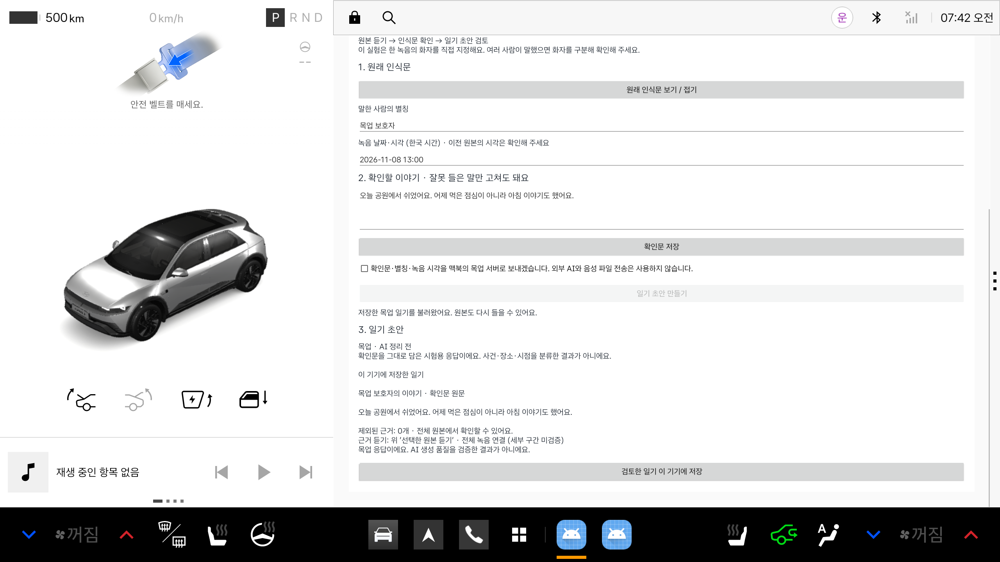

# 목업 생성 → 기기 저장 → 다시 읽기·듣기

2026-11-09. 사용자 결정에 따라 OpenAI API 연결을 미루고 로컬 목업으로 진행했다.
FR-003/005/006/009/010, T017/T020/T021의 독립 probe 흐름이며 실제 생성 품질·제품 동기화 완료가 아니다.

## 구현

- `pnpm probe:server` 기본은 mock이다. `.env.probe`의 `DIARY_GENERATOR=mock`을 명시했고, 공급자 키가 있어도 호출하지 않는다.
- `MockDiaryGenerator`는 매 요청의 확인문을 그대로 반환한다. 화자/입력 ID/전체 음성 범위/session/revision을 유지하며 다른 사례의 문장을 끼우지 않는다.
  한 발화를 한 묶음으로 담는 운송·저장 시험 응답이다. 의미 분류·정정·날짜/장소 추출을 구현한 것처럼 표시하지 않는다.
- 요청/응답에 `generation_mode`를 포함한다. 앱과 서버 모드가 다르거나 요청 모드가 없으면 공급자 호출 전에 409 MODE_MISMATCH.
  모델 입력 allowlist에는 이 로컬 모드를 넣지 않는다. 외부 OpenAI 실패를 목업으로 자동 대체하지 않는다.
- 연결 스크립트가 토큰과 서버 모드를 앱 전용 파일로 전달한다. API 키·녹음 파일은 복사하지 않는다.
- 생성 전 안내는 ‘맥북의 목업 서버’로 표시한다. 초안·저장본·재열람에 ‘목업 · AI 정리 전’을 유지하며 재열람 안내도 저장 상태에 맞춘다.
- AtomicFile에 generation_mode/model/prompt_version을 함께 보관한다. 예전 모드 없는 저장본은 기존 OpenAI 경로 기록으로 읽고, 새 응답은 알려진 모드만 채택한다.
- 입력 수정 시 확인/확정 revision을 무효화하고 이전 초안은 남긴다. 원본 WAV와 인식문 이력을 덮어쓰지 않는다.

## 실행 검증

| 범위 | 관측 |
|---|---|
| TypeScript | typecheck 및 변경 파일 Prettier 통과 |
| 자동 테스트 | Vitest 84개 통과. 기본 mock+키 존재 시 fetch 0회, 서로 다른 입력/화자·범위 보존, 취소/잘못된 입력, 명시적 OpenAI 미설정 오류, 양방향 모드 불일치 차단 포함 |
| Kotlin | JVM 12개 통과 |
| Android | probeDebug·probeDebugAndroidTest·pleosRelease 빌드 성공. 최종 UI 수정 후 probe APK/기기 검사 APK 재빌드 |
| Pleos emulator-5580/user 10 | 최종 `OK (2 tests)`, 2.283초. 저장/수정 revision 검사와 목업 HTTP 생성·저장·Activity 재열기·원본 MediaPlayer 시작 검사 |
| 원본 보존 | 합성 WAV SHA256 불변, 원래 인식문 이력 보존, 수정 후 이전 초안 확정 불가 |
| 실제 API | 0회. 목업 실행 중 provider transport를 구성/사용하지 않음 |

기기 테스트는 자체 생성한 8초 무음 WAV와 합성 텍스트만 사용했다. 실제 음성을 인식한 결과가 아니며
MediaPlayer가 재생 상태로 들어가는 것을 확인했다. 사용자의 기존 녹음을 읽거나 전사·내보내지 않았다.
테스트 자료는 종료 시 자기 파일만 정리한다. 앱/사용자 데이터를 clear하지 않았다.
앱 프로세스 강제 종료·전원 장애 복구 검증이 아니라 Activity 재열기+디스크 재로드 검증이다.



Pleos 가로 화면에서 목업 표시·원문·저장 상태·재열람 안내·전송 동의를 시각적으로 확인했다.
`ui-ux-pro-max`의 성공/오류 피드백·텍스트 상태 표시를 적용했다. 기존 56dp 버튼을 유지했다.
휴대폰 크기·다크 모드·최대 글꼴·스크린리더 검증을 이번 차량 probe 검사에 포함하지 않았다.
스크린샷은 저장본을 재열람한 상태이며 다시 생성하려면 전송 안내를 다시 확인해야 한다.

## 재현

```sh
# .env.probe.example 참고: DIARY_GENERATOR=mock. 기존 .env.probe의 비밀값을 덮어쓰지 않는다.
pnpm probe:server
# 별도 터미널
./scripts/vehicle-gradle.sh :app:assembleProbeDebug :app:assembleProbeDebugAndroidTest
.tools/android-sdk/platform-tools/adb -s emulator-5580 install -r apps/vehicle/app/build/outputs/apk/probe/debug/app-probe-debug.apk
.tools/android-sdk/platform-tools/adb -s emulator-5580 install -r apps/vehicle/app/build/outputs/apk/androidTest/probe/debug/app-probe-debug-androidTest.apk
./scripts/connect-diary-probe.sh
.tools/android-sdk/platform-tools/adb -s emulator-5580 shell am instrument --user 10 -w -e class 'io.hmg.familydiary.ReviewDeviceTest#editsPersistWithoutChangingAudioAndStaleResultsAreRejected,io.hmg.familydiary.ReviewDeviceTest#mockGenerationSavesReopensAndReplaysTheSameOriginal' io.hmg.familydiary.probe.test/androidx.test.runner.AndroidJUnitRunner
```

현재 기기의 Android user는 10이다. 다른 기기는 `am get-current-user`로 확인한다.
기존 `reviewScreenConfirmsAndPreservesTextOnUnconfiguredGeneration` 기기 검사는 이번 mock 실행에서 선택하지 않았다.
그 검사는 별도로 OpenAI 모드/빈 키·모델 서버를 연결해 실행해야 하며 mock 모드로 통과했다고 주장하지 않는다.
서버의 NOT_CONFIGURED 처리는 이번 Node 검사에서 계속 검증했다.

사용자 수동 흐름: 모의 P·공동 녹음 안내 확인 → 원본 선택/STT → 화자·확인문 저장 →
목업 서버 전송 안내 확인 → 일기 초안 만들기 → 검토한 일기 이 기기에 저장.
다시 열어 같은 원본을 선택하면 저장한 목업 일기를 읽고 위의 원본 듣기로 재생할 수 있다.

## 남은 범위

실제 API 품질·세부 구간 정렬·자동 다화자·가족 인증·Docker 영속 서버·차량/휴대폰 동기화·제품 삭제 계약은 별도다.
이번 목업은 생성 공급자 경계만 대체한다. 다음 제품 단계는 Compose/Postgres/인증/비공개 저장을 연결하고 양쪽 기기의 동기화·재청취를 검증하는 것이다.
