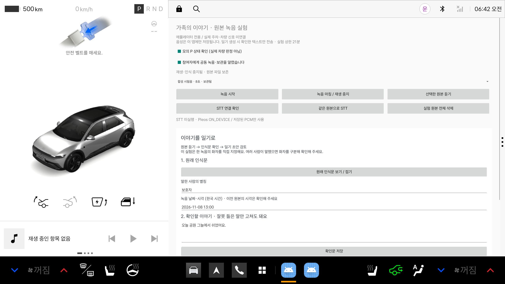

# 인식문 검토 → 일기 초안 실험

2026-11-08. FR-003/005/006/010/013/014, T017/T020의 독립 실험 기반이다.
**실제 모델 호출·내용 품질 통과·전체 제품 구현을 완료한 결과가 아니다.**

## 연결한 흐름

1. 기존 probe의 같은 PCM STT 완료 콜백을 상태 문구 파싱 없이 검토 화면에 전달한다.
2. 원래 인식문 이력과 사용자의 확인문을 분리한다. STT를 다시 실행해도 기존 확인문을 덮어쓰지 않는다.
3. 사용자가 화자 별칭·녹음 시각·확인문을 저장한다. 원본을 재생하면서 문장을 수정할 수 있다.
   이 단계는 녹음 하나당 수동 화자 한 명이며 자동 화자 구분/가족별 연속 발화 UI 완료가 아니다.
4. 전송 안내 확인과 생성 버튼 이후 확인문·별칭·시각·기술 ID/원본 전체 시간 범위만 요청한다.
   음성 바이너리·SHA256·차 번호·좌표·원래 인식문 이력은 공급자 입력에 포함하지 않는다.
5. 응답 스키마·근거 ID·화자·시간 범위·입력 전체 사용/제외를 서버에서 검증한다.
   모델이 추측한 세부 시각은 거부하고 이 실험의 근거는 각 입력의 전체 범위만 허용한다.
6. 초안의 사건·시점·검토 필요 사항과 제외된 근거 수를 표시한다. 사용자가 검토 후 기기에 저장한다.
   원문 수정은 revision을 올리며 확인·확정 상태를 무효화한다. 이전 초안은 이전 버전으로 표시한다.

`ReviewStore`는 앱 전용 `capture-review/<원본 파일명>.json`의 AtomicFile을 사용한다.
SHA256/길이가 다른 원본에 기존 확인문을 붙이지 않는다. 수정 중인 내용도 화면 이탈/원본 변경 시 보관한다.
저장 실패 시 입력을 유지하고 실패를 표시한다. 원본 전체 삭제는 관련 검토 데이터도 함께 삭제한다.
제품용 암호화 저장·보관함 동기화·서버 삭제 계약은 아직 미구현이다.

## 서버와 공급자 경계

- `pnpm probe:server`: 127.0.0.1:4319만 listen. 256-bit 토큰은 `.tools/probe/token`에만 생성한다.
- `connect-diary-probe.sh`: adb reverse와 앱 전용 연결 토큰 설정. 공급자 API 키/음성을 기기로 복사하지 않는다.
- probe에만 INTERNET + localhost cleartext 예외. pleos 제품 flavor의 주차 불명 잠금은 유지한다.
- Origin 포함 요청·잘못된 토큰·과도한 입력을 거부한다. 서버에 원문 로그/영속 사본을 만들지 않는다.
- OpenAI Responses, `store:false`, strict JSON Schema, 도구 없음, 요청 취소/시간 제한, 거절·불완전 응답 구분.
  `store:false`를 공급자의 모든 데이터 보관이 없다는 뜻으로 표시하지 않는다.
- API 키·모델 미설정은 `NOT_CONFIGURED`. UI에 실패를 알리며 가짜 성공/합성 일기로 대체하지 않는다.
- 최대 입력은 직렬화 후60,000문자/200발화, 출력12,000토큰의 실험 설정이다.
  긴 입력 window 정리·durable jobs·제품 인증·HTTPS·Docker Compose 서비스 완료는 아니다.

## 실행 검증

| 범위 | 결과 |
|---|---|
| TypeScript | typecheck 통과 |
| 계약·저장·도메인·생성 adapter·로컬 서버 | Vitest74개 통과. 새 생성/서버 검사16개 포함 |
| Kotlin 기존 캡처·WAV·STT 누적 | JVM12개 통과 |
| Android 빌드 | probeDebug, probeDebugAndroidTest, pleosRelease 성공 |
| 검토 기기 검사 | 최종 `OK (2 tests)`, 0.908초. 합성 자료만 사용한2개 시나리오: 원본 불변·수정문 복구·이전 revision 거부·주차 해제 숨김·생성 설정 오류 보존 |
| 실제 OpenAI 호출 | 0회. 키·사용 가능한 모델 미설정으로 미실행 |
| 실제 자유 발화·세부 구간·가족별 화자·양쪽 동기화 | 미검증/미구현 범위 유지 |



Pleos 가로 화면의 한국 시간 표시·확인문 입력·접기 동작을 확인했다. 휴대폰 크기·다크 모드·최대 글꼴·스크린리더는 이 차량 실험 화면에서 검증하지 않았다.

서버 테스트의 응답은 네트워크를 대체한 **합성 계약 응답**이며 모델이 실제로 쓴 일기가 아니다.
유료 API·Claude Code로 우회 실행하지 않았다. 자동 검사는 기존 사용자 녹음을 읽어 전사하거나 내보내지 않았다.

기기 검사 재현은 provider 키가 없는 별도 로컬 서버에서 실행한다:

```sh
pnpm probe:server
./scripts/connect-diary-probe.sh
./scripts/vehicle-gradle.sh :app:assembleProbeDebug :app:assembleProbeDebugAndroidTest
.tools/android-sdk/platform-tools/adb -s emulator-5580 install -r apps/vehicle/app/build/outputs/apk/probe/debug/app-probe-debug.apk
.tools/android-sdk/platform-tools/adb -s emulator-5580 install -r apps/vehicle/app/build/outputs/apk/androidTest/probe/debug/app-probe-debug-androidTest.apk
.tools/android-sdk/platform-tools/adb -s emulator-5580 shell am instrument --user 10 -w -e class io.hmg.familydiary.ReviewDeviceTest io.hmg.familydiary.probe.test/androidx.test.runner.AndroidJUnitRunner
```

## Claude 웹 품질 실험

사용자 결정에 따라 앱은 OpenAI API로 구현하고, 내용 탐색은
[claude-web-experiments 스킬](/Users/lee/.codex/skills/claude-web-experiments/SKILL.md)의 웹 구독 경로로 분리했다.

2026-11-09 갱신: 최초 브라우저 연결 차단은 이후 승인된 native Chrome 제어로 해소했다.
사용자가 요청한 비공개 Claude 프로젝트에서 **Haiku 5.5 중간**으로 개발4건·평가2건을
각각 새 대화로 실행했다. 실제 전송6/완료6/미수집0, 추가 API 호출0이다.
형식·근거 검사는6건 모두 통과했으나 장소 라벨 누락·충돌 표현·검토 표시의 개선점이 있다.
전체 응답·입력 해시·UI 조건·한계는 [웹 실험 보고서](g3-generation.md)에 기록했다.
앱의 OpenAI API 통합은 유지하며, 웹 결과를 해당 API의 검증으로 대체하지 않는다.

## 다음 검증

1. 웹 기준선에서 발견한 장소 라벨·충돌 표현·검토 표시 규칙을 보정하고, 새 평가 입력으로 재검증한다.
2. `.env.probe`의 키·모델을 사용자가 설정하면 합성 입력으로 실제 OpenAI 응답과 초안 저장 경로를 검증한다.
3. 제품 경로는 실제 P/UX·암호화·가족 인증·DB 작업자·동기화 선행 조건을 완료한 뒤 활성화한다.

공급자 형식은 [공식 Structured Outputs 문서](https://developers.openai.com/api/docs/guides/structured-outputs?api-mode=responses)를 확인했다.
스키마 적합성과 근거 범위 검사는 의미적 충실도를 보장하지 않으므로 내용 평가와 사용자 검토를 별도로 유지한다.
