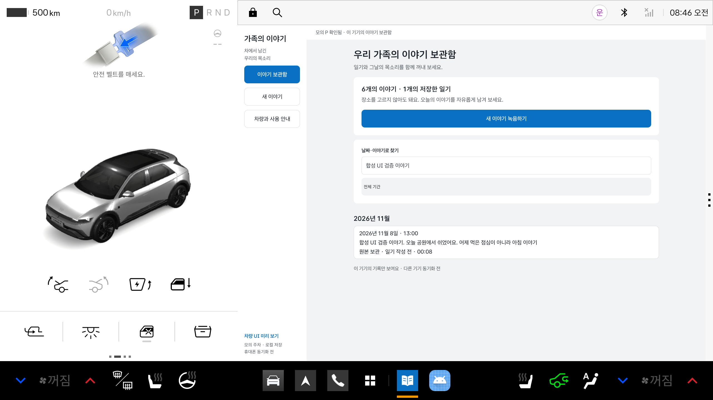
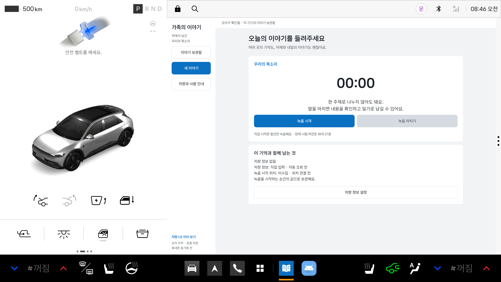
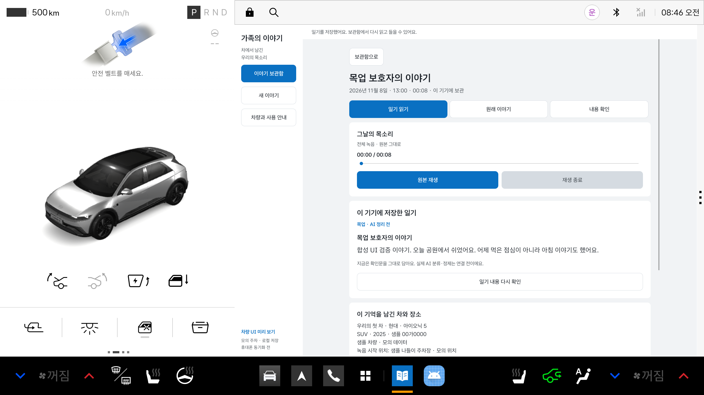
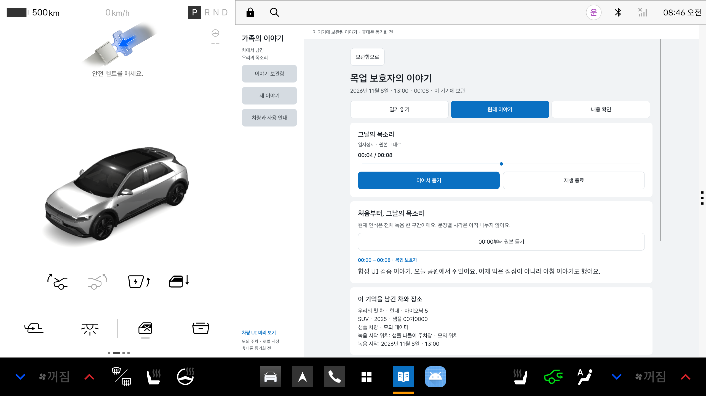
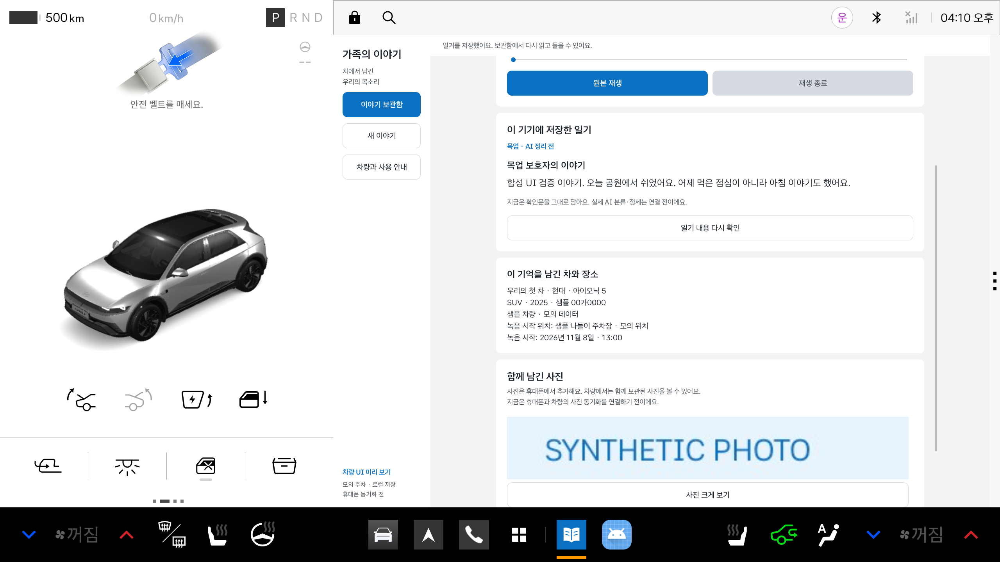
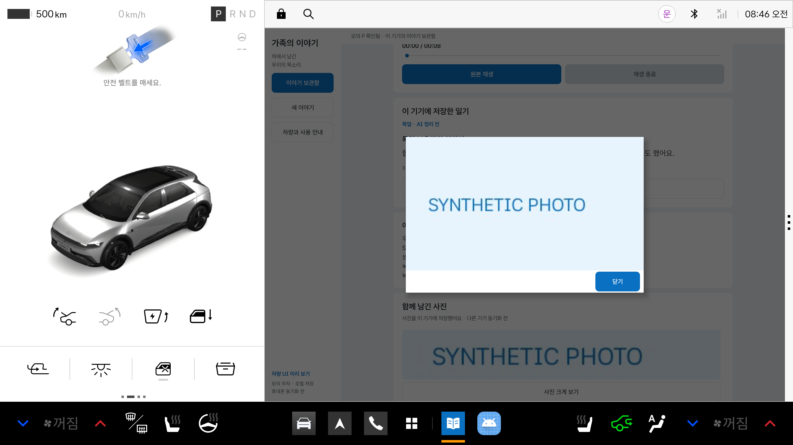
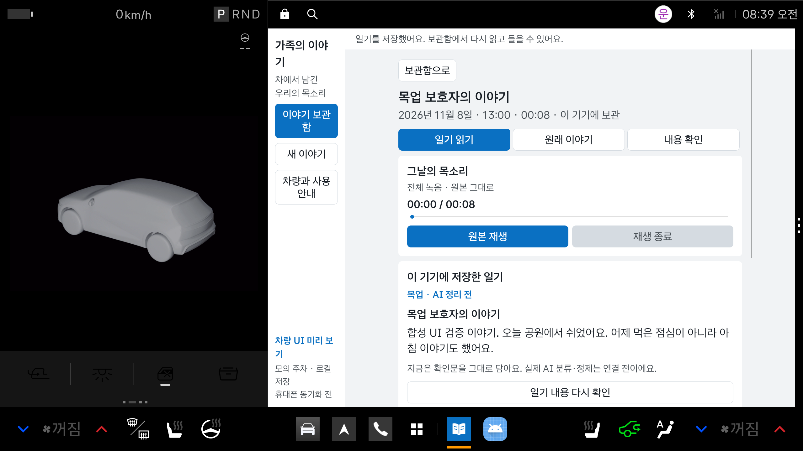

# 차량 UI 통합 검증

2026-11-09. 사용자가 승인한 웹 디자인을 차량용 화면으로 옮기고 기존 캡처·STT·목업·로컬 저장에 연결했다.
FR-001~006/009/010/012/016~018의 **에뮬레이터 내 흐름**이다. 실차 주차 판정·인증·양쪽 기기 동기화의 완료가 아니다.

## 후속 결정: 사진 첨부는 휴대폰/웹에서

사용자가 차량의 파일 저장 미지원 안내를 확인하여 차량의 사진 추가 버튼과 ACTION_OPEN_DOCUMENT 호출을 제거했다.
차량에는 사진 열람·확대·개별 삭제와 ‘휴대폰에서 추가, 동기화 연결 전’ 안내를 유지한다.
아래 사진 선택기 검증은 **이전 구현의 이력**이며 현재 차량 기능이 아니다. 후속 UI 검사는 저장소에 합성 사진을 준비해 열람을 검사한다.
후속 probe/test APK 빌드 성공, 첨부 버튼 부재·사진 확대/재열람·주차 중단·일기 저장/재생/삭제 UI 검사 1개가 7.235초에 통과했다.

## 현재 실행 화면

에뮬레이터의 **가족의 이야기 · 차량 미리 보기**(파란 책 아이콘, `io.hmg.familydiary.probe`).
기존 앱 ID와 `capture-probe`/`capture-review`를 유지하고 APK를 `install -r`로 갱신했다. 앱 데이터를 초기화하지 않았다.
웹 `http://localhost:3018/demo`는 합성 화면 미리 보기로 남으며, 차량에서 새로 저장한 기록과 아직 공유되지 않는다.

1. 모의 P·공동 녹음 안내를 확인한다.
2. **새 이야기 → 녹음 시작 → 녹음 마치기**. 완료 원본의 상세 화면으로 이동한다.
3. **내용 확인 → 음성을 글로 옮기기**. 별칭·확인문 저장 → 목업 전송 안내 확인 → 초안 만들기 → 검토 후 저장.
4. **일기 읽기**에서 저장 결과를 확인하고 **원래 이야기**에서 원문과 같은 전체 녹음을 읽고 듣는다.
5. 보관함에서 기록 연월·기간·날짜/내용/별칭 검색으로 다시 연다.

저장 원본은 재생·일시정지·탐색·종료가 가능하다. 현재 STT의 시간축은 전체 녹음 한 구간이다.
문장별 시각이나 자동 화자 분리를 만들어 내지 않는다. 화면 이탈·모의 P 해제·오디오 포커스 상실은 중단하며 자동 재개하지 않는다.
앱 화면에서 나갔다 돌아오면 모의 P를 다시 확인한다.

## 차량·위치·사진

- 차량 설정은 별명·제조사·모델·차종·연식·선택적 번호를 수동으로 저장한다. 새 녹음 시작 때 복사하며 이후 프로필 변경으로 덮어쓰지 않는다.
- `memory-context/<original-id>`는 원본과 연결된 context와 사진의 로컬 저장소다. 이전 녹음에 맥락이 없으면 없다고 표시한다.
- 위치 API는 미연결이다. 기본값은 **위치 미수집**, 사용자가 샘플 위치를 켜면 시작 시각과 **모의 위치** 출처를 저장한다. 실제 좌표·주행 경로를 수집하지 않는다.
- 사진은 사용자가 고른 JPG/PNG/WebP만 가져온다. 8장/장당 10MB/최대 4천만 화소를 검사하고 최대 변 1600px 이하로 축소한다. EXIF 방향을 적용한 픽셀을 JPEG로 재인코딩해 EXIF 위치를 복사하지 않는다.
- 사진의 재열람·확대·개별 삭제를 제공한다. 이야기 삭제는 해당 원본·검토 기록·차량 맥락·사진을 함께 제거한다. 네트워크 동기화 삭제/오류 복구 계약은 별도 구현이다.
- 차량 정보·사진·위치는 생성 요청에 추가하지 않았다. OpenAI는 계속 명시적 mock 모드이며 실제 API 호출은 0회다.

## 실행한 검사

| 검사 | 관측 결과 |
|---|---|
| 빌드 | probeDebug·probeDebugAndroidTest 성공, 기존 pleosRelease 빌드 성공 |
| Kotlin JVM | 12개 통과: PCM 5, 캡처 상태 4, STT 누적 3 |
| ReviewDeviceTest | 4개 통과, 15.532초. 저장 revision·원본 보존, HTTP 목업 생성·저장·Activity 재열기·재생/일시정지/탐색·P 해제, 차량/사진 저장, 실제 Pleos STT→확인 화면 |
| 삭제 보강 | 같은 UI 검사에 개별 이야기 삭제 후 WAV·JSON·사진/context 부재 검사를 추가해 재실행, 1개 통과, 7.190초 |
| CaptureProbeDeviceTest | 1개 통과, 35.031초. 호스트 마이크를 끈 30초 무음 캡처·정상 종료·원본 재생·P 해제·중단 캡처 보존, 검사 후 호스트 마이크 복원 |
| 사진 저장 | 실제 테스트 소유 content URI를 입력해 가져오기·표시·Activity 재열기 확인. OS 선택기 자체는 ActivityMonitor로 결과를 전달하며, 사용자의 사진은 선택하지 않음 |
| 사진 경계 | 형식/10MB/9번째 사진 거부, 다른 기록 사진 삭제 차단, EXIF 방향 90도 보정·GPS 메타데이터 제거, 삭제 후 재로드 |
| 큰 글자/야간 OS | font_scale=2.0 + night=yes에서 UI 흐름 1개 통과, 6.515초. 앱은 명시적 밝은 테마를 유지함 |

테스트 텍스트·차량·위치는 합성이다. UI/STT에는 생성한 음성 또는 8초 무음 WAV만 사용했다.
자체 생성한 파일만 정리했으며 개인 음성을 읽어 출력하거나 스크린샷에 넣지 않았다.
보관함 스크린샷도 합성 검증 문구로 필터했다. 기존 파일 수는 화면에 표시되나 내용은 노출하지 않는다.

처음 사진 UI 검사는 선택기 IntentFilter와 복귀 후 주차 재확인 단계가 빠져 실패했다.
실패를 앱 기능 통과로 처리하지 않고 테스트가 실제 흐름을 따르도록 수정한 뒤 위 결과를 얻었다.

## 시각 점검

웹의 승인된 k-style 토큰을 `VehicleTheme`으로 옮겼다. 네이티브 버튼·입력·체크박스·스크롤을 사용하며
64dp 행동 버튼, 8dp 이상 간격, 눌림/초점/비활성 표시와 텍스트 상태를 제공한다.
`ui-ux-pro-max`의 터치·접근성·큰 글자 기준을 참고했다. 흰 바탕 대비는 기본 글자 16.60:1,
보조 글자 8.19:1, 파랑/흰 버튼 글자 5.11:1이다. 신규 자체 애니메이션은 없다.









2560×1440 Pleos 가로 환경을 시각적으로 확인했다. 큰 글자에서는 줄바꿈·스크롤을 유지한다.
600×1200으로 화면을 임시 축소했을 때 Pleos 시스템이 앱 영역을 화면 밖에 유지했다.
그 실행의 논리 검사는 통과했지만 화면에 앱이 보이지 않아 **좁은 화면/375px 검증 통과로 인정하지 않는다**.
화면 크기·글꼴 배율·OS 야간 설정을 모두 원래 상태로 복원했다. 별도 휴대폰 UI/스크린리더 검증은 남아 있다.

## 재현

```sh
pnpm probe:server
./scripts/install-capture-probe.sh
./scripts/connect-diary-probe.sh
# 모드 설정 후 앱 재실행
./scripts/vehicle-gradle.sh :app:assembleProbeDebugAndroidTest
.tools/android-sdk/platform-tools/adb -s emulator-5580 install -r apps/vehicle/app/build/outputs/apk/androidTest/probe/debug/app-probe-debug-androidTest.apk
.tools/android-sdk/platform-tools/adb -s emulator-5580 shell am instrument --user 10 -w -e class io.hmg.familydiary.ReviewDeviceTest io.hmg.familydiary.probe.test/androidx.test.runner.AndroidJUnitRunner
```

실제 계정/기기 권한, 서버 영속화·동기화, 실차 P/위치 연동, 정확한 세부 시간축, 자동 다화자,
사진의 다른 기기 전송, 위치 기반 과거 기록 추천은 이 로컬 화면 통합으로 완료되지 않았다.
